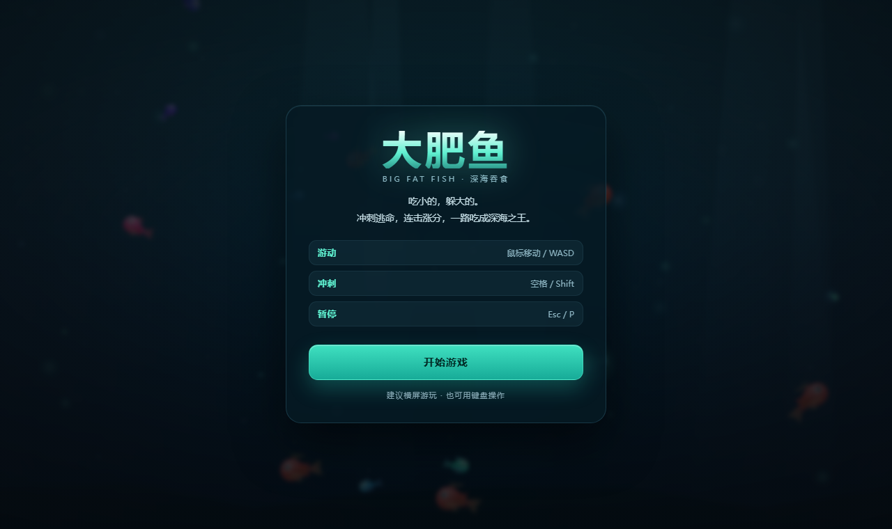
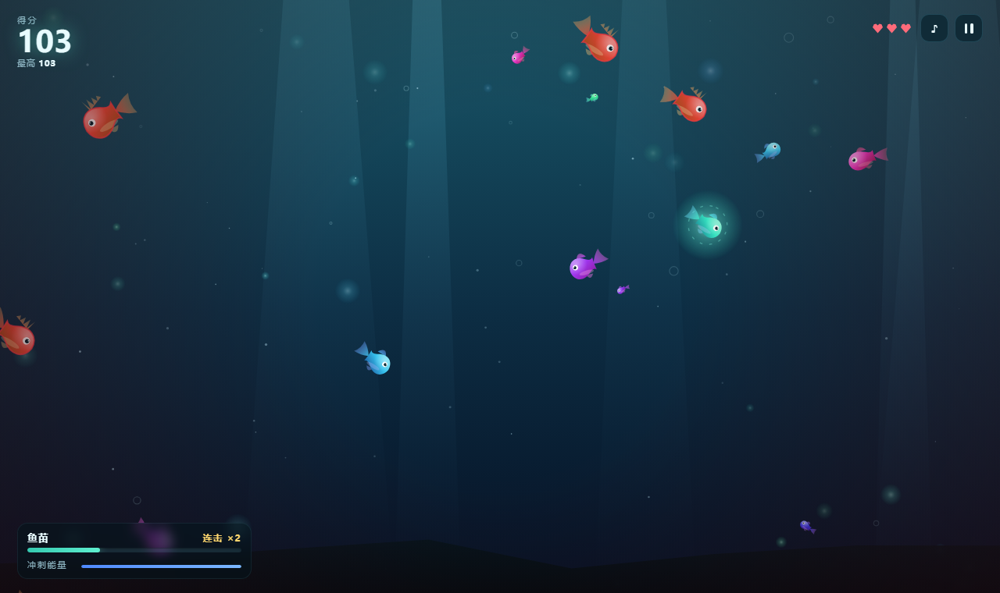
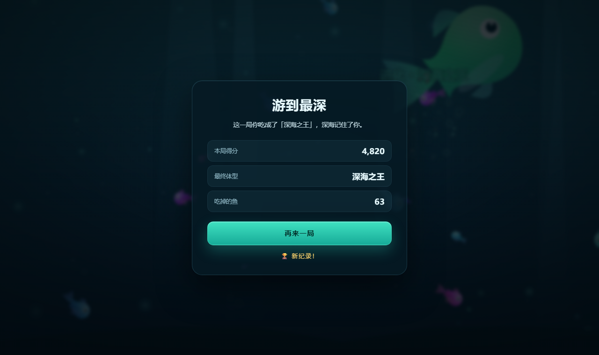
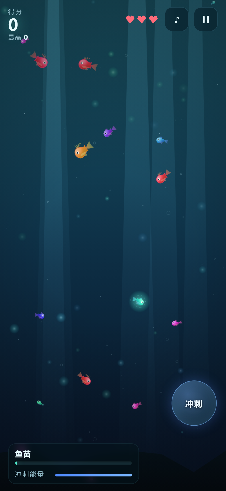
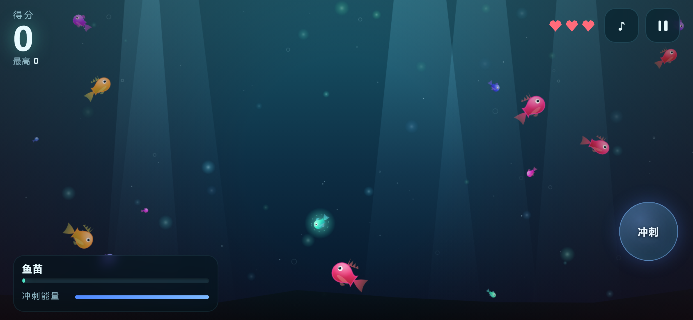
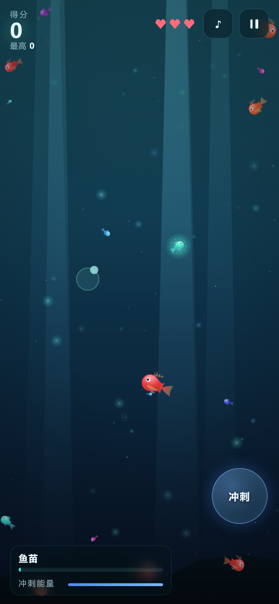

# 大肥鱼 · 深海吞食

一款纯前端的深海吞食成长小游戏。吃小鱼长大，躲大鱼活命，一路吃成深海之王。

**零依赖 · 零构建 · 零安装** —— 双击 `index.html` 就能玩，手机浏览器打开也能直接玩。

[](LICENSE)


---

## 截图

| 桌面 · 开始 | 桌面 · 游戏中 |
| --- | --- |
|  |  |

| 桌面 · 结算 | 手机 · 竖屏 |
| --- | --- |
|  |  |

| 手机 · 横屏 | 手机 · 拖动操控 |
| --- | --- |
|  |  |

---

## 快速开始

### 方式一：直接打开

双击 `index.html`。零依赖零构建，浏览器直接执行。

### 方式二：本地静态服务（推荐，避免个别浏览器的本地文件限制）

```powershell
npx serve .
# 或
python -m http.server 8080
# 或
npx http-server -p 8080
```

### 方式三：在线游玩

部署到 GitHub Pages 后，直接用手机浏览器打开：

```
https://xuyueling97-ctrl.github.io/big-fat-fish-deep-sea/
```

---

## 操作方式

| 操作 | 键鼠 | 触屏 |
| --- | --- | --- |
| 游动 | 鼠标移动（指哪游哪）/ WASD / 方向键 | 左下角摇杆（推得越远游得越快） |
| 冲刺 | 空格 / Shift | 右下「冲刺」按钮 |
| 暂停 | Esc / P | 右上暂停按钮 |
| 开始 / 重开 | Enter | 点击按钮 |

**触屏用固定摇杆**：左下角常驻摇杆，拇指按住底盘任意位置即可推动，摇杆头跟随手指并被限制在底盘内，推到底为全速，中心 15% 为死区（避免误触）。摇杆之外的水域仍保留**相对拖拽**作为备选：手指按下处为基准点，拖动方向与距离决定游动方向，滑动约 72px 即达全速。鼠标则保留原始的绝对跟随手感，PC 体验不受影响。

**手机强制横屏**：竖持手机时舞台整体顺时针旋转 90°，玩家看到的始终是横屏画面。Android 上同时尝试 `screen.orientation.lock('landscape')`；iOS Safari 不支持方向锁定，由 CSS 旋转兜底，两种路径手感一致。

---

## 玩法

### 核心规则：体型决定生死

屏幕上每条鱼都有颜色信号，看一眼就知道能不能碰：

| 视觉信号 | 含义 | 应对 |
| --- | --- | --- |
| 正常颜色（青、蓝、紫） | **可以吃**，比你小 | 追上去吞掉 |
| 白色虚线描边 | **体型接近**，吃不下也撞不死 | 会被弹开，绕过去 |
| 红橙色 + 背部尖刺 | **致命掠食者**，比你大 | 立刻跑，或用冲刺逃命 |

吃到鱼会成长，成长带来权衡：**体型越大游得越慢**（最多降低 22%）。后半程要靠冲刺和路线规划，而不是无脑横冲。

### 成长阶段

鱼苗 → 小鱼 → 中鱼 → 大鱼 → 巨鱼 → **深海之王**

单局通常持续 **85–105 秒**。成长为递减曲线，越接近「深海之王」越难涨，避免后期数值爆炸。

### 计分与连击

- 吃掉越大的猎物，基础得分越高
- 2.3 秒内连续吞食累积**连击**，最高 ×12 倍率
- 被撞会**清空连击**，所以连击本身就是一种风险回报

### 生命与强化

**3 条命**。被致命鱼撞到掉 1 条，并获得 1.5 秒无敌闪烁和击退。掉光 3 条命，本局结束。

| 强化道具 | 效果 |
| --- | --- |
| 四角星（青） | 直接 +150 分 |
| U 形磁铁（蓝） | 9 秒内自动吸引周围小鱼 |
| 盾牌（金） | 7 秒无敌，且可以撞碎大鱼 |

### 深海压迫感

当致命掠食者靠近，屏幕边缘泛起红色警戒光晕，越近越强。这是留给你按下冲刺的最后提示。

威胁永远是可读、可躲的，不会被围死：

- **大鱼有配额**：比你大的鱼最多占鱼群的 30%，不会随着游玩时长越积越多
- **追兵有限**：同一时刻只有最近的 2 条大鱼会主动追击，其余保持漫游，总有一条逃生缝隙
- **跑得掉**：掠食者的速度上限被限制在玩家基础速度的 1.06 倍，靠操作可以甩开
- **受伤冲击波**：被撞时会震开周围 240px 内的大鱼，给无敌时间结束后的脱离窗口

### 彩蛋 🥚

在开始界面**连续点击标题「大肥鱼」7 下**（触屏与鼠标都可以），会解锁一个彩蛋：

- 播放一段专属的上扬琶音
- 提示「金鳞锦鲤」已解锁
- 此后**每一局开局**都会在附近海域出现一条金色锦鲤，游得快、只此一条，吃掉额外 **+500 分**

解锁状态记录在 `localStorage`（`bigfatfish.egg`），清缓存或换设备需要重新点。

---

## 移动端适配

手机浏览器打开即可玩，无需安装 App。

- **固定摇杆操控**：左下角常驻摇杆，拇指热区、单手可玩；摇杆外的水域仍可用相对拖拽
- **独立冲刺按钮**：右下大号圆形按钮，拇指热区；桌面端完全隐藏
- **强制横屏**：竖持手机时画面整体旋转 90°（Android 另尝试方向锁定），始终以横屏游玩
- **3×3 大地图**：世界为 3 屏宽 × 3 屏高，相机前瞻跟随、环形绕回，游到边缘从对面出现
- **自适应**：世界坐标以短边为基准缩放，切换方向后按比例迁移实体与相机，鱼不会跑出屏幕
- **安全区适配**：HUD、摇杆与按钮使用 `env(safe-area-inset-*)`，避开刘海与手势条；触屏横屏下成长面板右移让位摇杆
- **后台自动暂停**：切到后台（来电、切 App、锁屏）自动暂停，回来不会被"隔空吃掉"
- **防止误触**：禁止双击缩放、长按选中、双指手势缩放
- **触摸能力检测**：基于 `pointer: coarse` + `hover: none` 判断，真正收到触摸事件才启用触屏 UI。触屏笔记本用鼠标操作时不会误显示触屏界面

已通过 6 种设备视口验证：iPhone 12（竖屏/横屏）、iPhone SE、Pixel 5、iPad、小屏横屏 667×375。

---

## 项目结构

```
大肥鱼小游戏/
├── index.html              页面骨架、HUD、开始/暂停/结算面板
├── style.css               深海主题样式、HUD 布局、响应式与安全区适配
├── LICENSE                 MIT
├── js/
│   ├── utils.js            数学工具（插值、色相环绕、帧率无关阻尼等）
│   ├── audio.js            WebAudio 程序化音效合成（无任何音频文件）
│   ├── render.js           鱼体绘制、发光贴图缓存、浮游粒子、光柱、海底
│   ├── game.js             核心玩法：实体、碰撞、成长、道具、HUD 数据
│   └── main.js             入口：输入绑定、主循环、界面切换、移动端细节
├── docs/screenshots/       README 配图
└── tests/                  无头浏览器自动化测试
    ├── smoke.js            冒烟测试：加载、异常、状态机链路、PC/触屏 UI 分支
    ├── world-math.js       世界/相机数学自检 + 大后期围攻压力回归（纯 Node，不需要浏览器）
    ├── late-pressure.js    大后期围攻压力：满级体型 + 6000 分的 A/B 对比
    ├── mobile.js           移动端兼容性：6 设备视口、真实触摸拖拽、横竖屏、后台暂停
    ├── curve.js            成长曲线采样（调数值后必跑）
    ├── stability.js        多分辨率 + 8 分钟压力 + 泄漏检查
    ├── bench.js            性能基准（预热 + 多轮取中位数）
    ├── shots.js            界面截图生成
    └── diag-touch.js       触摸能力诊断（排查 is-touch 判定问题）
```

### 技术要点

- **零依赖**：只有原生 JS + Canvas 2D，没有任何 npm 包或构建步骤，克隆即可运行
- **无素材**：所有鱼、粒子、光效都由代码绘制，音效由 WebAudio 实时合成，仓库里没有一张图片资源或一个音频文件
- **性能**：发光效果预渲染成贴图复用，避免每帧新建径向渐变。实测真实负载 **0.46 ms/帧**，627 粒子 + 60 条鱼的极端场景 **1.77 ms/帧**（60 fps 预算为 16.7 ms）
- **自适应**：以短边为基准缩放世界坐标，桌面、平板、手机横竖屏下鱼的大小比例一致
- **环形世界**：地图首尾相接，所有距离/方向计算统一用 `wrapDelta()` 取最短路径；折返周期在全工程统一为 `worldW`/`worldH`（不再带实体半径余量），相机始终折回玩家所在的世界带，因此穿越边缘时画面与鼠标操控都不会错位
- **幂等 `resize()`**：给 `canvas.width/height` 赋值会清空整个位图，尺寸没变时这类调用只会在 `draw()` 之后把画面抹黑一帧。所以布局尺寸未变时直接早退，不碰位图
- **无头验证**：通过 Chrome DevTools Protocol 驱动 Edge，自动捕获控制台异常、截图、模拟触摸与游玩

---

## 运行测试

需要 **Node 18+**（用到全局 `WebSocket`）和 **Microsoft Edge**（脚本里写死了默认安装路径 `C:\Program Files (x86)\Microsoft\Edge\Application\msedge.exe`，其他浏览器需自行改路径）。测试脚本会自行启动无头浏览器、起临时静态服务，无需手动准备。

```powershell
node tests/world-math.js  # 世界/相机数学自检 + 边界接缝回归 + 大后期围攻压力回归（纯 Node，最快）
node tests/smoke.js       # 冒烟：全链路 + PC/触屏 UI 分支是否正确
node tests/late-pressure.js # 大后期围攻压力 A/B（满级 + 6000 分，各跑 5 轮）
node tests/mobile.js      # 移动端：6 设备视口 + 真实触摸拖拽 + 横竖屏 + 后台暂停
node tests/curve.js       # 成长曲线：一局时长与得分曲线是否合理
node tests/stability.js   # 稳定性：多分辨率 + 长时压力
node tests/bench.js       # 性能：帧耗时基准
node tests/shots.js       # 生成界面截图到 tests/out/
node tests/diag-touch.js  # 触摸能力诊断（排查触屏 UI 不出现的问题）
```

截图与浏览器临时配置输出到 `tests/out/`，脚本会自动清理，不会残留（该目录已在 `.gitignore` 中）。

> 改动玩法数值（成长速率、生成比例、碰撞阈值）后，**务必重跑 `curve.js`**，确认单局时长仍在 85–105 秒区间。

---

## 部署到 GitHub Pages

本项目是纯静态站点，没有任何构建步骤，可直接托管。

### 方式一：网页端操作（无需装 Git）

1. 在 GitHub 新建仓库 `big-fat-fish-deep-sea`，**不要**勾选初始化 README
2. 在仓库页点击 **Add file → Upload files**，把项目文件拖进去
   - 必须上传：`index.html`、`style.css`、`js/`、`LICENSE`、`README.md`、`.gitignore`、`docs/`
   - **不要上传**：`.codely-cli/`、`tests/out/`（私有文件与测试产物）
3. 提交后进入 **Settings → Pages**
4. **Source** 选择 `Deploy from a branch`，分支选 `main`，目录选 `/ (root)`，保存
5. 等待约 1 分钟，访问 `https://xuyueling97-ctrl.github.io/big-fat-fish-deep-sea/`

> 所有资源引用都是相对路径，部署在 `/<仓库名>/` 子路径下无需任何修改。

### 方式二：命令行（需要 Git）

```bash
git init
git add .
git commit -m "feat: 大肥鱼 · 深海吞食"
git branch -M main
git remote add origin https://github.com/xuyueling97-ctrl/big-fat-fish-deep-sea.git
git push -u origin main
```

推送后在 **Settings → Pages** 按上面的方式开启即可。

---

## 已知取舍

- **没有存档进度**：只有最高分存进 `localStorage`（键 `bigfatfish.best`）。这是刻意的，一局完整结束才算数
- **音效开关**也会存入 `localStorage`（键 `bigfatfish.sound`）
- **无多人 / 无排行榜**：纯单机体验
- 无头环境测出的绝对帧耗时会受软件渲染影响而偏高，判断性能请用 `bench.js` 的中位数而非单次采样
- 无头触摸模拟需要在页面加载**之前**开启；若在加载后开启，测试需调用 `window.__fishConfirmTouch()` 补判定（`tests/mobile.js` 已处理）

---

## 许可

[MIT](LICENSE) —— 可自由使用、修改、分发，包括商业用途。

游戏代码与美术均由代码程序化生成，不依赖任何第三方素材；音效为 WebAudio 实时合成，无版权素材引入。
